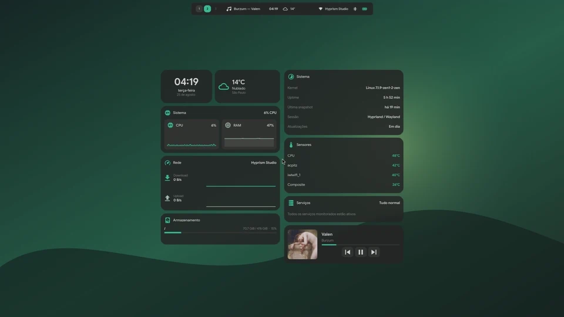
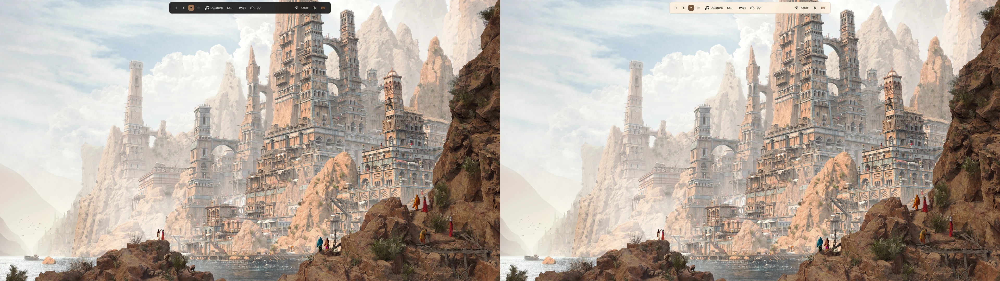
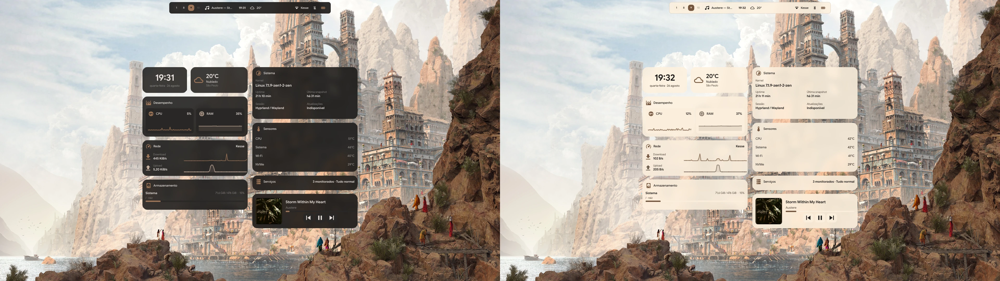
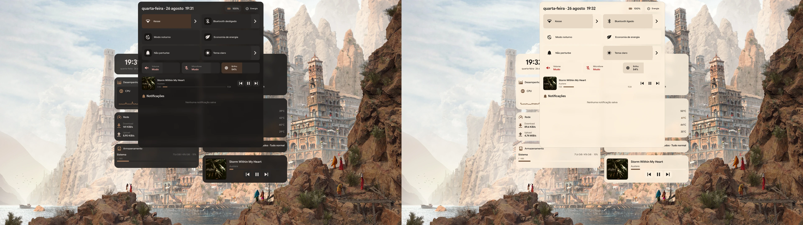
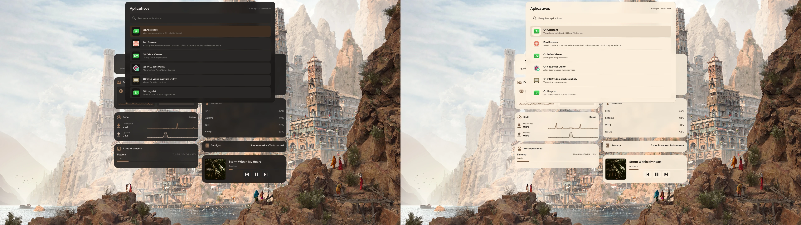

<p align="center">
  
</p>

<h1 align="center">Hyprism</h1>

<p align="center">
  <strong>A cohesive, wallpaper-driven Hyprland desktop built with Quickshell.</strong>
</p>

<p align="center">
  <a href="https://archlinux.org/"></a>
  <a href="https://hypr.land/"></a>
  <a href="https://quickshell.org/"></a>
  <a href="https://github.com/InioX/matugen"></a>
</p>

## Overview

Hyprism is an automated dotfiles environment for a personalized Hyprland session. Quickshell provides the morphing island, panels, notifications, desktop widgets, and a native lock screen; Matugen turns the current wallpaper into one semantic palette shared throughout the desktop.

It is opinionated: it manages a complete session rather than acting as a component library, with language, weather, widget visibility, monitors, and appearance kept in one declarative configuration.

## Features

### Shell

- Compact and expanded island with workspaces, window context, status, battery, and media state.
- Hub with NetworkManager, Bluetooth, audio, brightness, power profiles, Do Not Disturb, notifications, media, and appearance controls.
- App Launcher, Clipboard, Emoji Picker, Wallpaper Picker, Power Menu, recording selector, OSD, notification popups, and history.
- Fast morphing transitions and focus-following keyboard navigation across interactive panels.

### Desktop

- Bento-style widgets for clock, weather, performance, network, storage, system information, sensors, services, tasks, processes, and media.
- Persistent per-widget controls through `hyprism-shell` and `user.json`.
- Hyprland configuration in Lua for monitors, workspaces, layouts, rules, gestures, keybindings, animations, and autostart.

### Theming

- Wallpaper-derived dark and light semantic palettes, or a fixed preset: Nord, Tokyo Night, Catppuccin, Gruvbox, Everforest, Rosé Pine, or Black & White.
- Four light-palette temperature levels and optional scheduled light/dark switching.
- Coordinated output for Quickshell, Hyprland, Hyprlock, SDDM, GTK, Qt/Kvantum, Kitty, Foot, hyprtoolkit, Starship, tmux, Neovim, Fastfetch, and Zathura.
- Live palette updates for the running shell and supported terminal/toolkit applications.

### Utilities

- Native and Flatpak application indexing, Wayland portals, clipboard history, screenshots, monitor or region recording, color picking, session locking with a native Quickshell lock screen ([guide](docs/lockscreen.md)), and night mode.
- English and Brazilian Portuguese interfaces with live language switching.
- A stable user-facing CLI plus Makefile workflows for installation, updates, validation, reloads, and removal.

## Preview

[](assets/demo/hyprism-tour.mp4)

| Desktop and compact island | Desktop widgets |
| --- | --- |
|  |  |
| **Hub** | **App Launcher** |
|  |  |

More in the [gallery](docs/gallery.md).

## Installation

Install the latest stable release from the AUR and initialize the user configuration:

```bash
paru -S hyprism-shell
hyprism-shell init
```

Use `hyprism-shell init --lang pt-BR` for Brazilian Portuguese. `hyprism-shell-git` tracks `main` for unreleased changes, and a repository-managed install is available with `make install`. See the [installation guide](docs/installation.md) for requirements, the manual installer, and uninstalling.

## Documentation

| Topic | Guide |
| --- | --- |
| Install, update, requirements | [Installation](docs/installation.md) |
| `user.json` fields | [Configuration](docs/configuration.md) |
| Commands and shell actions | [CLI reference](docs/cli.md) |
| Clock, weather, system cards | [Desktop widgets](docs/desktop-widgets.md) |
| Native lock screen | [Lock screen](docs/lockscreen.md) |
| Palettes and presets | [Theming](docs/theming.md) |
| Default shortcuts | [Keybindings](docs/keybindings.md) |
| English and PT-BR | [Localization](docs/localization.md) |
| Layout, contributing, credits | [Development](docs/development.md) |
| Screenshots and video | [Gallery](docs/gallery.md) |

Preview the Astro documentation website locally with Docker Compose using `make website` (default `http://localhost:4321`). See the [website development notes](docs/development.md#documentation-website) for authoring, alternate ports, and cleanup commands.

## Contributing

Use the [issue chooser](https://github.com/kristyancarvalho/hyprism/issues/new/choose) for bugs and requests, and run `make check` before proposing a change. Details are in the [development guide](docs/development.md).

## License

Hyprism is available under the [MIT License](LICENSE). Credits and third-party licenses are listed in the [development guide](docs/development.md#credits-and-licenses).
