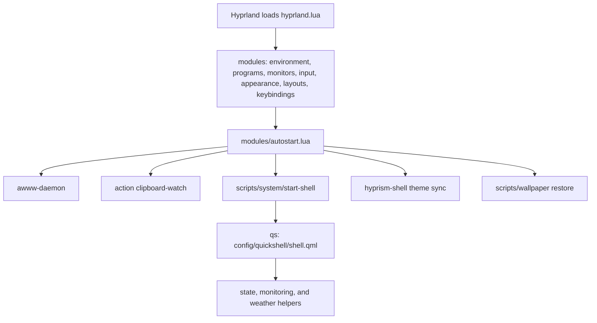
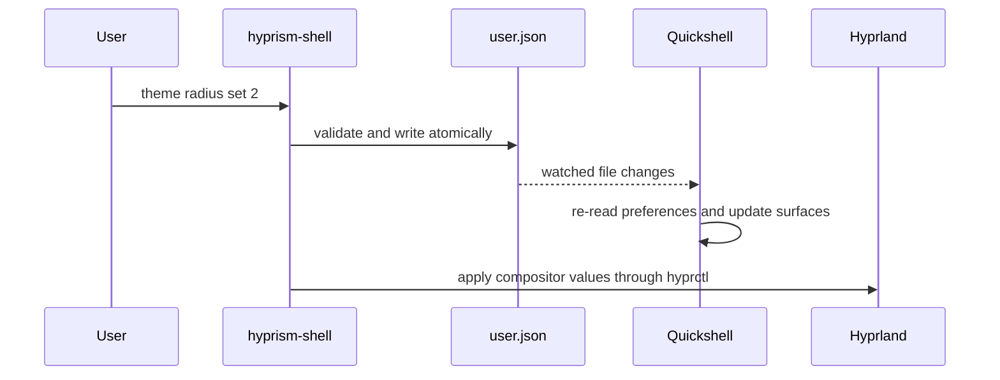

Hyprism is a complete Hyprland session, not a library of components. It ships Hyprland configuration written in Lua, a Quickshell desktop shell written in QML, a Python command-line tool, and a set of shell and Python helpers. One file, `~/.config/hyprism/user.json`, holds every personal preference, and a wallpaper-driven theme generator writes matching colors for the shell, the compositor, and supported applications.

## What Hyprism manages

| Area | Managed by Hyprism | Left to the system |
| --- | --- | --- |
| Compositor | Hyprland configuration: monitors, layouts, rules, keybindings, animations, autostart | Hyprland itself, GPU drivers |
| Shell | Island, Hub, panels, notifications, OSD, desktop widgets, lock screen | The Wayland protocols they use |
| Theme | Palettes for Quickshell, Hyprland, Hyprlock, SDDM, GTK, Qt/Kvantum, terminals, editors | Application-specific themes outside that list |
| Preferences | `user.json`, edited through `hyprism-shell` | Other dotfiles not linked by the installer |
| Services | Read-only monitoring of selected systemd units | Starting, stopping, or enabling units |
| Authentication | The `hyprism-lock` PAM service, which includes `system-auth` | The distribution PAM stack |

## Session startup

Hyprland loads `config/hypr/hyprland.lua`, which requires one module per concern from `config/hypr/modules/`. The autostart module launches the shell and its helpers once the compositor is ready.

`config/hypr/modules/programs.lua` decides where the runtime lives. It uses `HYPRISM_ROOT` when set, then `~/.local/share/hyprism` for a repository install, and otherwise `/usr/share/hyprism` for the AUR packages. Every script path is derived from that root, which is how the [development session](development.md#development-session) runs a checkout without installing it.

## How a preference reaches the screen

The shell watches `user.json` and reloads preferences when it changes, so most changes appear without a restart. Commands that affect the compositor, such as layout, radius, and blur, also apply the new values to the running Hyprland instance. Palette and appearance changes regenerate the theme files under `~/.cache/hyprism/theme`.

## Shell services

The QML shell keeps its data providers small and delegates system access to helper processes that print JSON.

| Provider | Implementation | Data |
| --- | --- | --- |
| `SystemService` | `scripts/system/state-daemon.py` | CPU, memory, GPU (through `nvidia-smi` when present), volume, brightness, battery, Bluetooth, NetworkManager state, power profile, night mode |
| `SystemService` | `scripts/system/weather.py` | Current weather from Open-Meteo for the configured coordinates |
| `MonitoringService` | `scripts/system/monitoring-daemon.py` | Storage, sensors, uptime, system identity, pending updates, Snapper snapshots, monitored units, top processes |
| `MediaService` | Quickshell `Mpris` module | Active media player and its controls |
| `AppService` | `scripts/system/desktop-index.py` | Native and Flatpak application entries for the launcher |
| `ClipboardService` | `scripts/system/clipboard-history.py` | Clipboard history |
| `RecordingService` | `scripts/system/recording-backend` | Screen recording state |

`MonitoringService` runs its helper only while at least one widget that needs it is enabled.

## Repository layout

### Top level

| Path | Responsibility |
| --- | --- |
| `config/` | Everything installed as configuration: Hyprland, Quickshell, terminals, toolkits, PAM, SDDM, and defaults |
| `scripts/` | The `hyprism-shell` CLI, wallpaper and theme tools, and session helpers |
| `themes/` | Vendored session themes, currently the KSDDM login theme with its upstream license |
| `wallpapers/` | Built-in wallpapers, as PNG with SVG sources, copied when the user has none |
| `packages/` | Package lists read by `install.sh`: `pacman.txt` and `aur.txt` |
| `packaging/aur/` | AUR recipes: a `PKGBUILD.in` template for `hyprism-shell` and the `PKGBUILD` for `hyprism-shell-git` |
| `tests/` | Python `unittest` suite, plus a QML focus test run with `qmltestrunner` |
| `docs/` | This documentation; the only copy, also read by the website |
| `website/` | Astro documentation website and its Docker workflow |
| `assets/` | Branding, screenshots, and demo video used by the README and website |
| `.github/` | Issue forms, pull request template, and GitHub Actions workflows |
| `install.sh`, `uninstall.sh` | Repository install, migration, and archival removal |
| `Makefile` | Entry points for install, checks, the development session, and the website |

### Configuration

| Path | Responsibility |
| --- | --- |
| `config/hypr/` | `hyprland.lua`, its `modules/`, plus Hyprlock and hyprtoolkit configuration |
| `config/quickshell/` | The shell; see the next table |
| `config/user.json` | Default preferences merged into the user's file by `hyprism-shell init` |
| `config/lockscreen/widgets.json` | Default visibility of the lock screen widgets |
| `config/theme/` | `palettes.json` for preset palettes and `presets.json` for opacity, radius, blur, and defaults |
| `config/matugen/` | Templates that turn a wallpaper into theme files |
| `config/pam/hyprism-lock` | PAM service installed as `/etc/pam.d/hyprism-lock` |
| `config/sddm/` | SDDM configuration for the login screen |
| `config/applications/` | Desktop entries for keyboard setup and screenshots |
| `config/environment.d/`, `config/systemd/` | Session environment and the night mode user unit |
| `config/kitty/`, `config/foot/`, `config/tmux/`, `config/nvim/`, `config/fastfetch/`, `config/shell/` | Terminal, editor, and prompt configuration |
| `config/gtk-2.0/`, `config/gtk-3.0/`, `config/gtk-4.0/`, `config/qt5ct/`, `config/qt6ct/`, `config/Kvantum/` | Toolkit settings that follow the theme |

### Quickshell shell

| Path | Responsibility |
| --- | --- |
| `shell.qml` | Desktop shell entry point: windows per monitor, IPC handlers, configuration loading |
| `lockscreen.qml` | Separate entry point for the lock screen process |
| `ShellController.qml` | Shared state and actions used by panels and widgets |
| `Design.qml`, `Theme.qml`, `I18n.qml`, `HyprlandService.qml` | Design tokens, palette, translations, and Hyprland state |
| `panels/` | Island, Hub, launcher, clipboard, emoji picker, network, Bluetooth, power, recording, wallpaper, theme settings, window switcher, notifications |
| `widgets/` | Desktop widget board and its layout |
| `components/` | Reusable controls and cards, including `MediaStrip.qml` and `ShellButton.qml` |
| `services/` | Data providers listed in [Shell services](#shell-services) |
| `lockscreen/` | Lock screen session, surface, panel, clock, date, battery, weather, and media |
| `notifications/`, `osd/` | Notification cards and the on-screen display |
| `i18n/` | `en.json` and `pt-BR.json` catalogs |
| `data/` | Bundled data such as the emoji list |

### Scripts

| Path | Responsibility |
| --- | --- |
| `scripts/hyprism-shell` | The CLI described in the [CLI reference](cli.md) |
| `scripts/wallpaper` | Set, randomize, list, and restore wallpapers, then propagate the theme |
| `scripts/theme/` | `generate-theme.py` and the Hyprland appearance helper |
| `scripts/system/` | Session helpers: shell startup and reload, IPC, lock screen launcher, data daemons, recording, brightness, keyboard backend |
| `scripts/aur/` | Release lookup and AUR publication used by the workflows |
| `scripts/dev/session` | The nested [development session](development.md#development-session) |
