## Current source

Captured from the latest source in the nested [development session](development.md#development-session), with the Ember wallpaper and the Gruvbox palette.

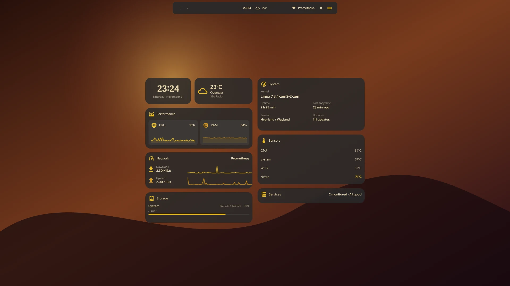

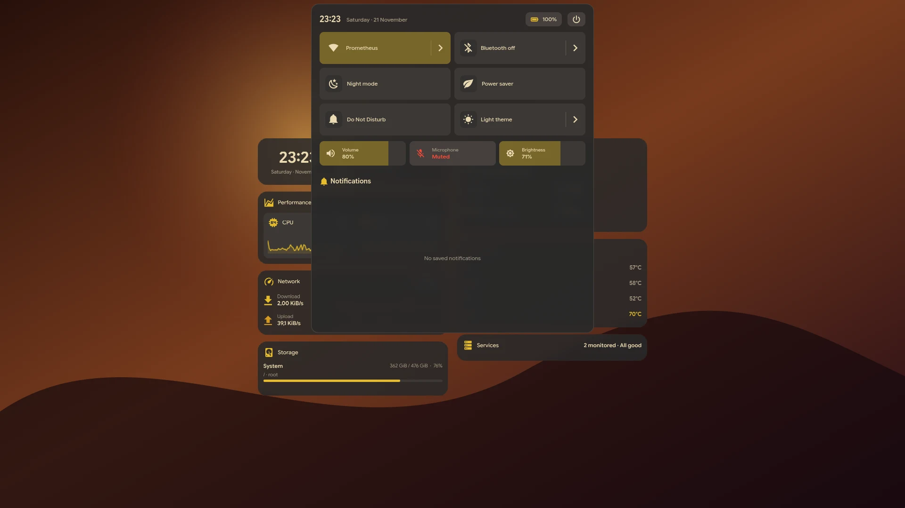

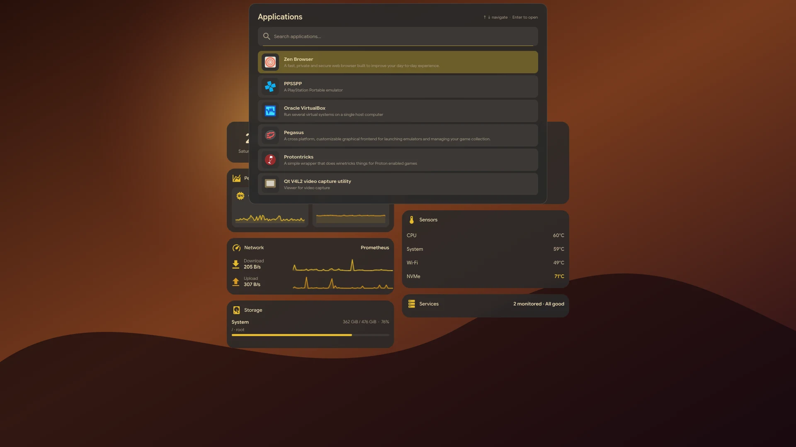

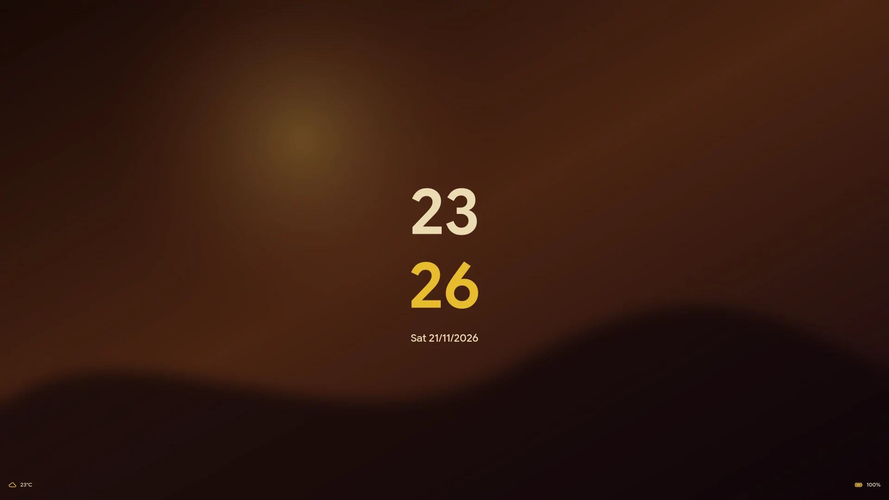

## Earlier releases

The images below show dark and light appearance from an earlier release.

# Gallery

Dark and light comparisons of the same interface with wallpaper-derived colors.

## Dark and light Hyprism desktop with the compact island

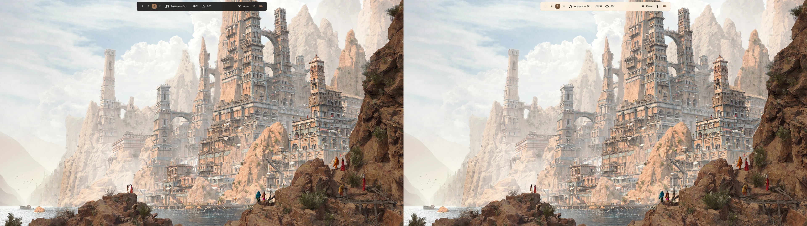

## Dark and light expanded Hyprism island

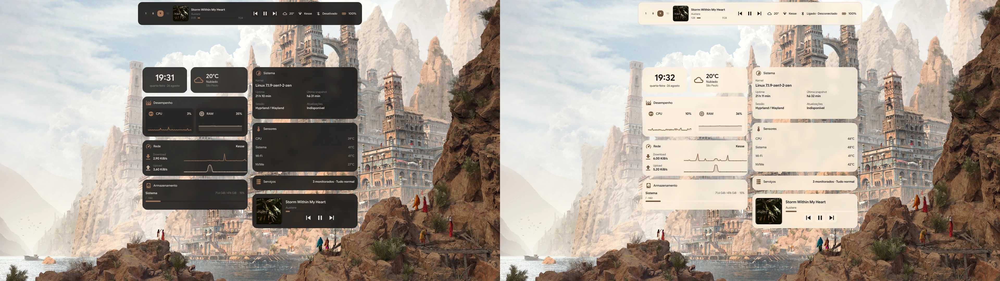

## Dark and light desktop widget dashboard

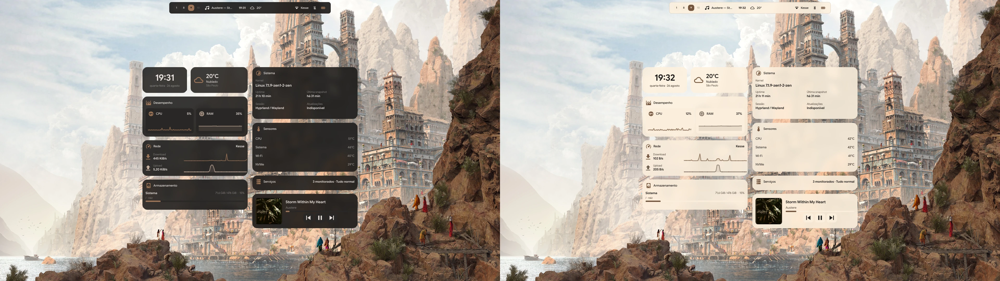

## Dark and light App Launcher

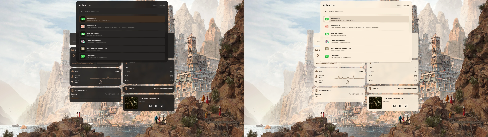

## Dark and light Hyprism Hub

## Dark and light notification history

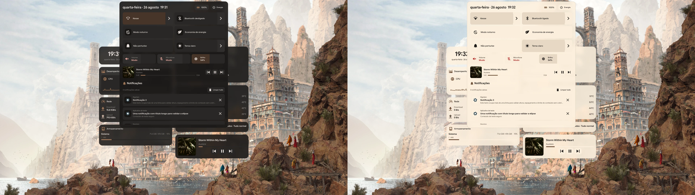

## Dark and light NetworkManager panel

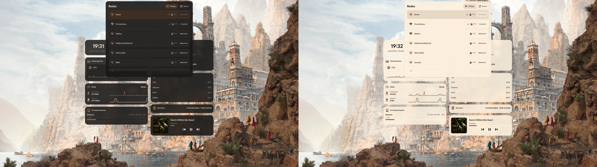

## Dark and light Bluetooth panel

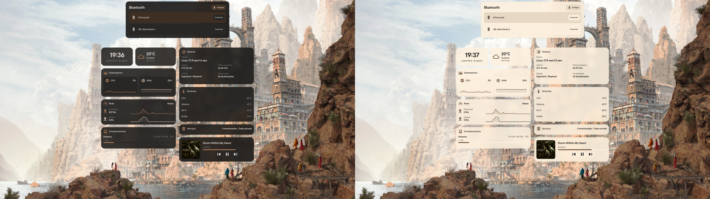

## Dark and light Clipboard panel

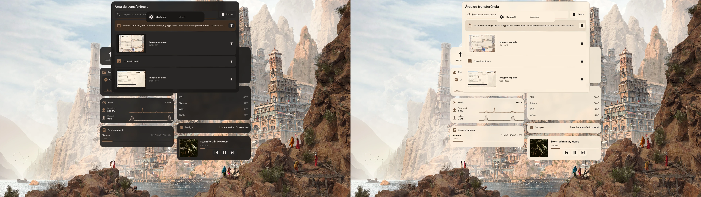

## Dark and light Emoji Picker

## Dark and light Power Menu

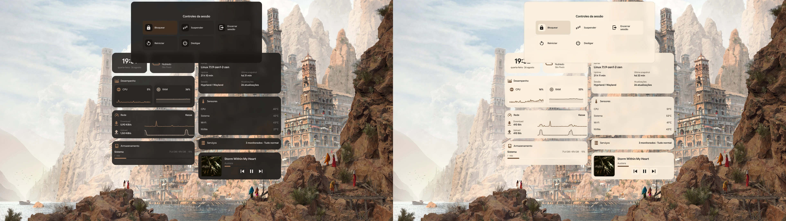

## Dark and light screen recording selector

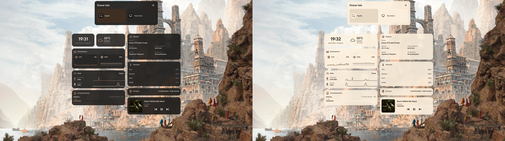

## Dark and light Wallpaper Picker

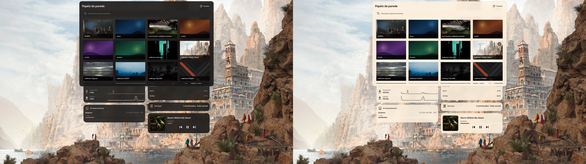

## Dark and light theme scheduling and temperature options

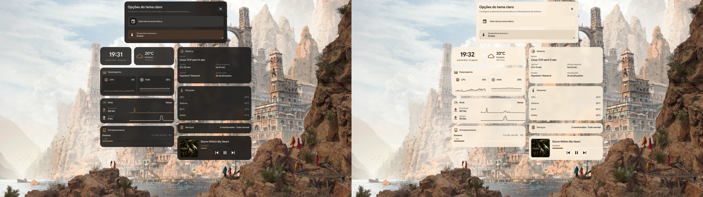

## Feature tour

[Animated tour](../assets/demo/hyprism-tour.mp4)
