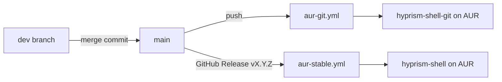

This page describes the release pipeline as it exists in the repository. It is meant for maintainers; users only need [Installation](installation.md).

## Branches and versions

Work happens on `dev`. A release merges `dev` into `main` with a `merge: <summary>` commit, then a GitHub Release is published on `main` with a `vX.Y.Z` tag. Versions are not written in any file: the AUR scripts read the version from the latest GitHub Release, and the VCS package derives its version from the distance to that tag.

Hyprism is in its `0.1.x` series. Each release increments the patch number, including releases that add features. Release notes use a short `## Changes` list written for users.

## Release flow



| Workflow | Trigger | Result |
| --- | --- | --- |
| `ci.yml` | Pull requests and pushes to `dev` and `main` | Validation only; never publishes |
| `aur-git.yml` | Push to `main`, or manual run | Updates `hyprism-shell-git` on the AUR |
| `aur-stable.yml` | Published GitHub Release, every six hours, or manual run | Updates `hyprism-shell` to the latest release |

Both AUR workflows run `scripts/aur/publish` in an Arch Linux container as an unprivileged user. For the stable package, the script downloads the release tarball, computes its SHA-256, fills `packaging/aur/hyprism-shell/PKGBUILD.in`, and resets `pkgrel` to `1` for a new version or increments it when only the recipe changed. It regenerates `.SRCINFO` with `makepkg --printsrcinfo` and pushes to the AUR over SSH with the `AUR_SSH_PRIVATE_KEY` secret. The scheduled run makes the stable package converge even if a release-triggered run fails. When nothing changed, no commit is pushed.

Both packages install through `make install-system PREFIX=/usr`, which copies `config/`, `themes/`, `wallpapers/`, and the runtime scripts to `/usr/share/hyprism`, installs `hyprism-shell` to `/usr/bin`, and installs the PAM service. The documentation, website, assets, and tests are not packaged.

## Checking a release

After publishing, confirm that both AUR workflow runs succeeded and that the AUR reports the new version:

```bash
curl -s 'https://aur.archlinux.org/rpc/v5/info?arg[]=hyprism-shell' | jq -r '.results[0].Version'
```

The AUR web interface can lag a few minutes behind the Git repository. To build the published recipe locally, clone `https://aur.archlinux.org/hyprism-shell.git` and run `makepkg`.

## Continuous integration

`ci.yml` has these jobs, all without secrets:

| Job | Checks |
| --- | --- |
| `tests` | The full `unittest` suite, including the QML focus test under an offscreen Qt platform |
| `shell` | ShellCheck at error severity on every tracked shell script in `scripts/` and `config/` |
| `workflows` | Every workflow file parses as YAML and defines jobs |
| `packaging` | Both PKGBUILDs pass `bash -n` in an Arch container |
| `website` | `astro check` and the production build of the documentation website |
| `website-container` | The website Compose file is valid and its development image builds |
