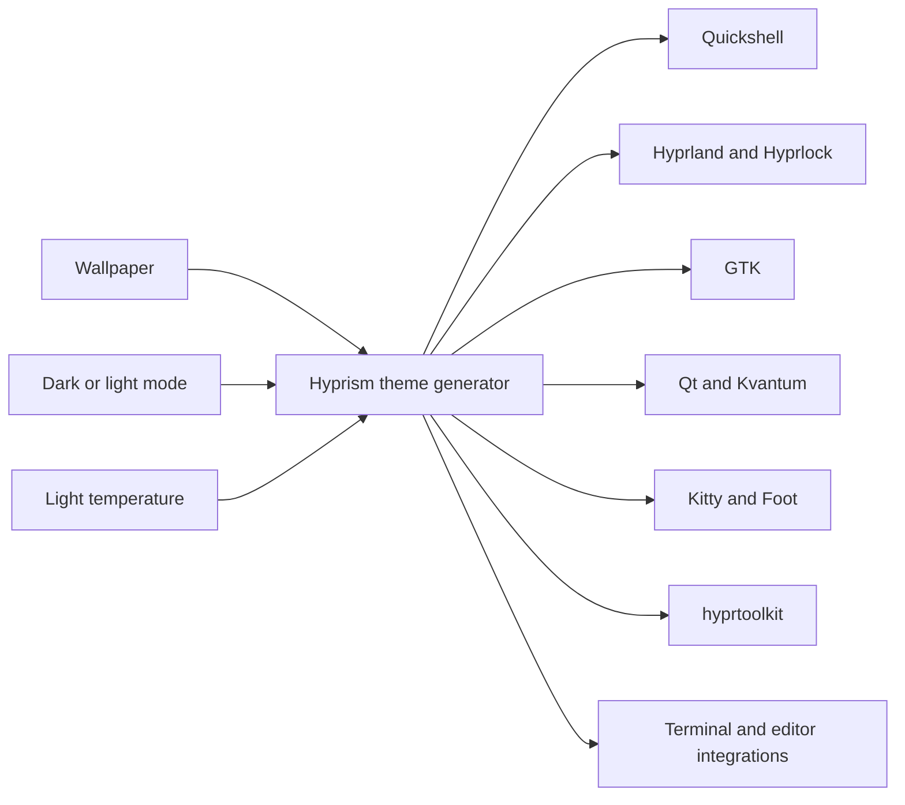

# Theming

Wallpaper color and appearance mode are inputs to one coordinated theme pipeline:

Changing wallpaper preserves the selected appearance. Changing appearance preserves the wallpaper. Dark mode is the default, automatic scheduling is opt-in, and light mode offers four temperature steps from neutral to amber.

Theme Settings → Theme chooses where the palette comes from. **Wallpaper** is the default and derives colors from the current wallpaper with Matugen. A preset fixes the palette instead, so changing wallpaper only changes the image. Presets follow the Auto, Light, and Dark appearance setting:

| Theme | Dark | Light |
| --- | --- | --- |
| Nord | Nord | Hyprism light variant built from the Nord palette |
| Tokyo Night | Storm | Day |
| Catppuccin | Mocha | Latte |
| Gruvbox | Dark | Light |
| Everforest | Dark (medium) | Light (medium) |
| Rosé Pine | Moon | Dawn |
| Black & White | Black surfaces, grayscale accents | White surfaces, grayscale accents |

Every output listed above follows the preset, including GTK through Colloid and the Hyprism-Papirus folder icons. White temperature applies to the Wallpaper theme only. Use `hyprism-shell theme palette set NAME` from a terminal.
