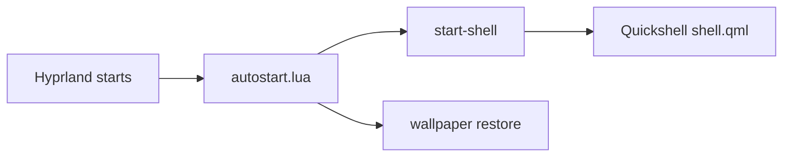
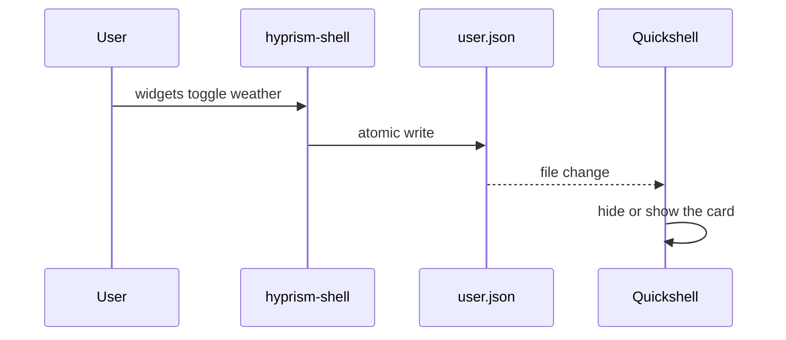
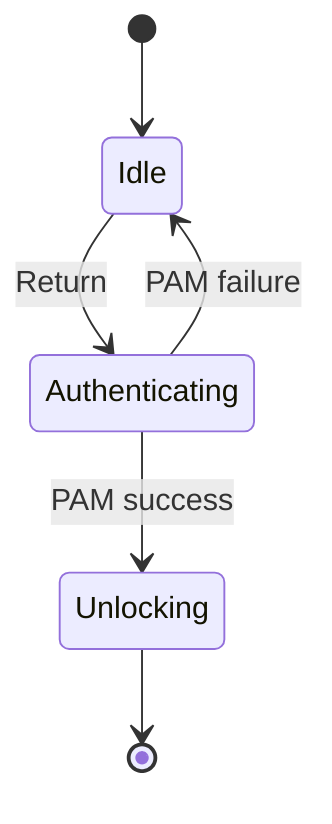
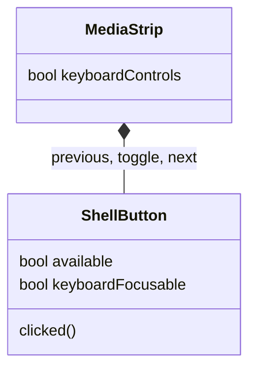
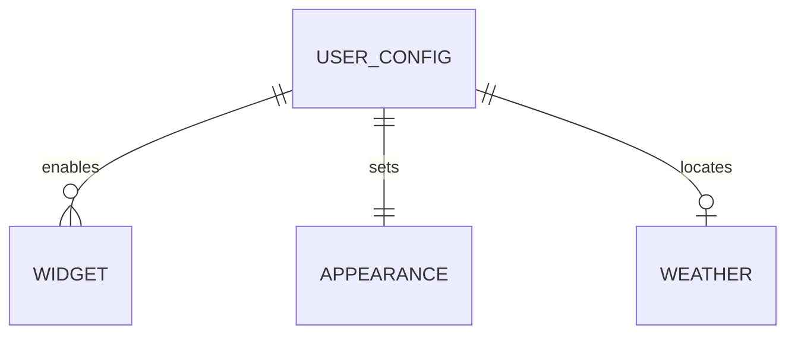

The Markdown files in `docs/` are the only copy of the documentation. GitHub renders them directly, and the Astro website in `website/` loads the same files through a content collection, so a change here appears in both places.

## Front matter

Each page starts with YAML front matter that the website uses for navigation and metadata.

| Field | Purpose |
| --- | --- |
| `title` | Page heading and navigation label |
| `description` | Summary under the heading and in search results |
| `category` | Group in the documentation sidebar |
| `order` | Position in the sidebar; lower numbers come first |
| `icon` | Lucide icon name shown next to the page |

## Links and images

Link to other pages with relative Markdown paths such as `[CLI reference](cli.md)`. The website rewrites them to its own routes, and GitHub follows them as files. Images under `assets/screenshots/` and `assets/demo/` resolve on both.

## Diagrams

Write diagrams as fenced code blocks with the `mermaid` language. No HTML or components are needed. The website renders them in the browser with the bundled Mermaid library, follows the light and dark theme, and scrolls wide diagrams horizontally. If a diagram has a syntax error, the page still loads and shows the diagram source with a short notice.

Use a diagram when it explains a flow or relationship better than prose. These examples show the supported types.

### Flowchart

### Sequence diagram

### State diagram

### Class diagram

### Entity relationship diagram

